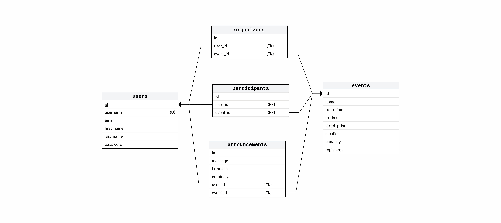

# Event Manager
An event management system written in Java using Spring for the backend and JavaFX for the frontend.

## Table of Contents
1. [Installation and Setup](#installation-and-setup)
2. [API Endpoints](#api-endpoints)
3. [Database schema](#database-schema)
4. [Third Party Libraries and Tools used](#third-party-libraries-and-tools-used)

## Installation and Setup
To try this project:
1. Clone this repository
2. Configure [application.properties](Backend/src/main/resources/application.properties) if you want to modify database settings
3. Create a database on your machine according to [application.properties](Backend/src/main/resources/application.properties) (only the database, tables are created automatically)
4. Run the backend and frontend at the same time.

## API Endpoints
While the backend is running, the API endpoints can be found as an HTML page at [http://localhost:8080/html-docs](http://localhost:8080/html-docs) or as a JSON file at [http://localhost:8080/json-docs](http://localhost:8080/json-docs).

This documentation is automatically generated using [swagger](https://swagger.io/).

## Database Schema

### What each table is used for:
- **users**: Stores user data to identify users and provide authentication
- **events**: Stores all events
- **organizers**: Links events to their organizer(s)
- **participants**: Links events to users participating in them
- **announcements**: Announcements made about events

## Tools used
This project uses PostgreSQL for the database.

It is written in Java.
It uses Spring for the backend, and JavaFx for the frontend.

*Detailed lists of dependencies can be found in the pom.xml files for both the [backend](/Backend/pom.xml) and the [frontend](/Frontend/pom.xml)*
